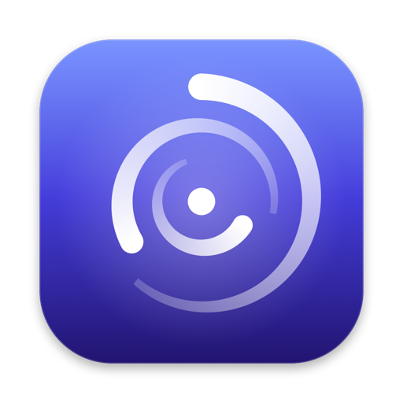
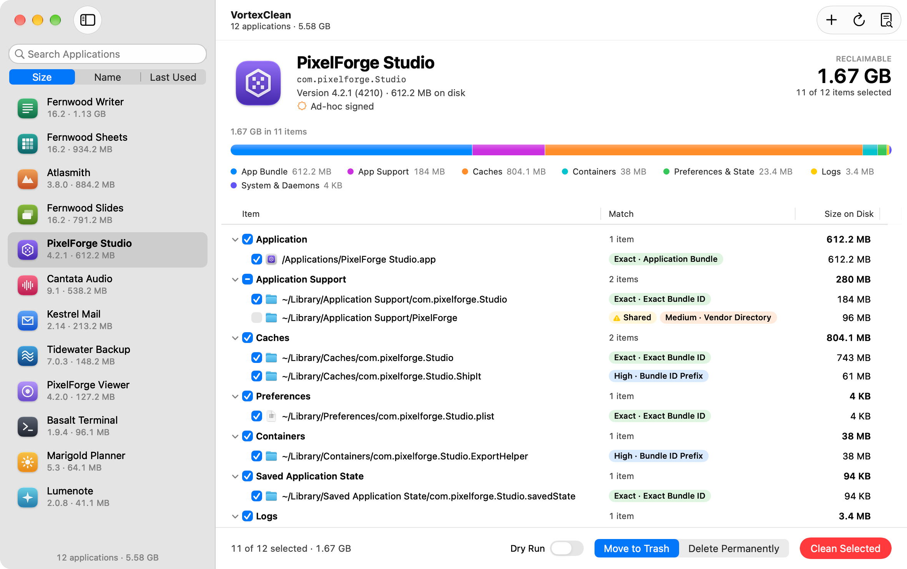
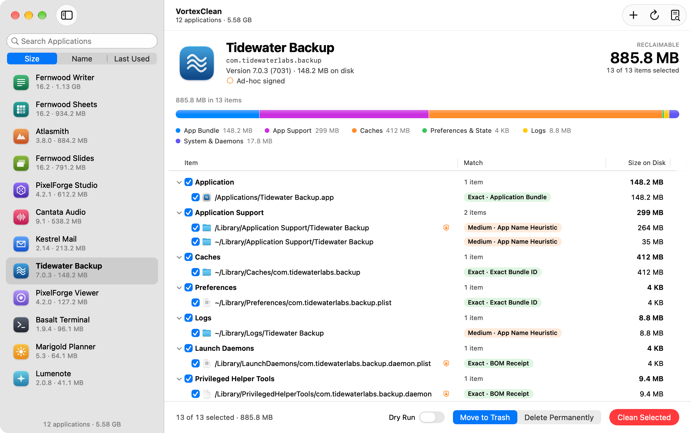
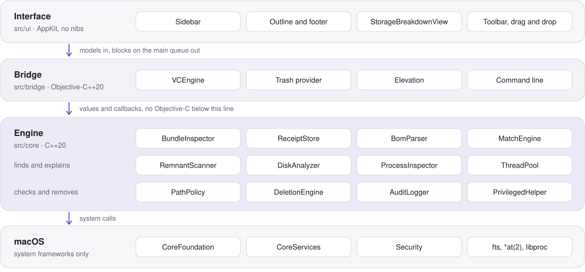

<p align="center">
  
</p>

<h1 align="center">VortexClean</h1>

<p align="center">
  <strong>Uninstall all of it. Touch nothing else.</strong><br>
  A native macOS uninstaller in C++20 and programmatic AppKit, with its own binary <code>.bom</code> parser.
</p>

<p align="center">
  <a href="https://berkayceylan.github.io/VortexClean/"><strong>Website and live demo</strong></a>
  &nbsp;·&nbsp;
  <a href="https://github.com/berkayceylan/VortexClean/releases/latest">Download</a>
  &nbsp;·&nbsp;
  <a href="#build">Build from source</a>
  &nbsp;·&nbsp;
  <a href="https://github.com/berkayceylan/VortexClean/issues">Issues</a>
</p>

<p align="center">
  <a href="https://github.com/berkayceylan/VortexClean/actions/workflows/ci.yml"></a>
</p>

<picture>
  <source media="(prefers-color-scheme: dark)" srcset="docs/assets/standard-dark.png">
  
</picture>

VortexClean finds an application's bundle and everything it left behind, shows why each
item was matched and how certain the match is, and removes your selection to the Trash or
permanently. Every attempt, including a dry run, writes a JSON audit report.

It is built from the C++20 standard library and macOS system frameworks. There is no
Electron, SwiftUI or third-party code, and nothing is shelled out to for scanning, sizing,
`.bom` parsing or deletion.

<sub>Screenshots show a synthetic disk of invented applications, scanned by the real
engine. <code>tools/capture_screenshots.sh</code> re-creates them.</sub>

## Verified

Measured on macOS 27.2 (arm64), Apple clang 21. CI runs the tests on macOS 26 as well.

| | |
|---|---|
| BOM parser against `lsbom` | 139 real receipts, 614,347 paths, 0 differences |
| Tests | 82 cases in 7 suites, in Debug, Release and sanitizer builds |
| AddressSanitizer, UndefinedBehaviorSanitizer | no reports from the suites or the instrumented interface |
| `leaks(1)` | 0 leaks in all 7 suites |
| Compiler warnings | 0 with `-Wall -Wextra -Wpedantic` |
| Idle CPU | under 0.1% with the window open (0.06 to 0.08 s over 90 s) |
| `otool -L` | system frameworks and libraries only |

Not exercised end to end: administrator removal (it needs a real password), the interface
on macOS versions before 27, and anything before macOS 26 (the deployment target is 13.0).

## Download

Get the app from the [latest release](https://github.com/berkayceylan/VortexClean/releases/latest).
It is for Apple silicon. On an Intel Mac, build from source (not tested).

The app is **ad-hoc signed and not notarized**, so macOS blocks it the first time. Open it
once and close the message, then go to System Settings ▸ Privacy & Security and choose
**Open Anyway**. To check first that the file was built from this repository by its release
workflow:

```bash
gh attestation verify VortexClean-1.0.0-macos-arm64.zip --repo berkayceylan/VortexClean
```

## Build

You need the Xcode Command Line Tools (`xcode-select --install`) and CMake 3.24 or later.
Full Xcode is not required.

```bash
git clone https://github.com/berkayceylan/VortexClean.git && cd VortexClean
```

```bash
cmake -S . -B build/release -DCMAKE_BUILD_TYPE=Release
```

```bash
cmake --build build/release -j8
```

```bash
open build/release/VortexClean.app
```

Building also renders the icon, signs the bundle ad hoc and verifies the signature. For a
Debug build use `-DCMAKE_BUILD_TYPE=Debug` and another build directory.

| Option | Default | Effect |
|---|---|---|
| `ENABLE_SANITIZERS` | `OFF` | AddressSanitizer and UndefinedBehaviorSanitizer everywhere |
| `VORTEX_BUILD_APP` | `ON` | Build the application bundle |
| `VORTEX_BUILD_TESTS` | `ON` | Build the CTest suite |
| `VORTEX_WARNINGS_AS_ERRORS` | `OFF` | Fail the build on any warning |

### Signing and Gatekeeper

The build is **ad-hoc signed and not notarized**. A copy you build yourself opens normally.
Gatekeeper blocks a copy that was downloaded or sent from another Mac until you allow it
(see [Download](#download)).

macOS hides some locations, such as other applications' containers, from every application
without **Full Disk Access**. VortexClean shows a banner when it could not read something,
with a button that opens the right Settings pane. An ad-hoc signature is tied to the exact
binary, so macOS may ask again after each rebuild.

## Try it safely

`--root` points the whole application at a synthetic disk. It uses a Trash inside that disk,
never contacts launchd and never asks for administrator rights.

```bash
build/release/tests/vortex_make_demo_disk /tmp/demo-disk "$PWD/build/release/tests/process_child"
```

```bash
build/release/VortexClean.app/Contents/MacOS/VortexClean --root /tmp/demo-disk
```

The headless commands print JSON and remove nothing. `--dry-run` writes an audit report.

```bash
VortexClean --list --sizes
```

```bash
VortexClean --scan /Applications/Example.app
```

```bash
VortexClean --dry-run /Applications/Example.app
```

`--help` also lists the self-test options (`--launch-check`, `--snapshot`, `--hover`, ...).

## How matching works

<picture>
  <source media="(prefers-color-scheme: dark)" srcset="docs/assets/package-dark.png">
  
</picture>

| Confidence | Evidence |
|---|---|
| Exact | The bundle itself, its bundle identifier, its declared groups, receipt payload |
| High | Identifier prefix, embedded helper identifiers, launchd job program |
| Medium | Distinctive application or executable name, vendor directory |

To avoid touching something that belongs to another application:

- Stop words and names under four characters never match. `com.apple.*` is never matched
  unless a verified receipt of a third-party application lists that exact item.
- An identifier that belongs to a longer-named sibling (`com.google.chrome.canary` for
  Chrome) is skipped. LaunchServices is asked whether another application owns it.
- Vendor directories and team groups are compared with every other installed
  application. Shared ones are listed **unchecked**, with a warning badge.
- A directory that contains an installed application is never offered as one unit.
- A location protected by SIP is never offered, even when a receipt lists it.

## How deletion works

Each path is checked again immediately before removal: lexically, for SIP and protected
roots, and through symlink-refusing descriptors. The order is validate, coalesce nested
items, remove as the user, then (only if needed, after confirmation) as administrator, then
write the audit report. Symbolic links are removed, never followed.

| Mode | Behaviour |
|---|---|
| Dry Run | Validates and measures; touches nothing |
| Move to Trash | `NSFileManager trashItemAtURL`; recoverable. The default |
| Delete Permanently | Opt-in, with a separate acknowledgement |

Reports go to `~/Library/Logs/VortexClean/audit-<timestamp>.json`. Item statuses:
`trashed`, `deleted`, `skipped_sip`, `skipped_permission`, `dry_run`, `error`, plus
`skipped_missing` for an item that was already gone.

## Architecture

<picture>
  <source media="(prefers-color-scheme: dark)" srcset="docs/assets/architecture-dark.svg">
  
</picture>

The engine is pure C++20 and knows nothing about Cocoa. The bridge is the only layer that
mixes the two. There are two kinds of child process: `/bin/launchctl bootout`, started with
`posix_spawn` and an argument vector because launchd has no public API for it, and
VortexClean's own binary run as root for items that need an administrator.

## Test

```bash
ctest --test-dir build/release --output-on-failure
```

With AddressSanitizer and UndefinedBehaviorSanitizer (any report fails the test):

```bash
cmake -S . -B build/asan -DCMAKE_BUILD_TYPE=Debug -DENABLE_SANITIZERS=ON && cmake --build build/asan -j8
```

```bash
ctest --test-dir build/asan --output-on-failure
```

Apple clang has no LeakSanitizer, so leaks are checked by running every suite under
`leaks(1)`. Use a build without sanitizers:

```bash
cmake --build build/release --target leaks
```

| Suite | Cases | Covers |
|---|---|---|
| `test_bom_parser` | 14 | Synthetic BOMs, truncation, cycles, corruption, fuzzing |
| `test_disk_analyzer` | 7 | Logical and allocated size, hard links, symlink loops, cancellation |
| `test_heuristics` | 26 | Matching, stop words, siblings, vendors, receipts, launchd, sandbox |
| `test_deletion_pipeline` | 12 | Dry run, Trash, permanent, SIP, elevation protocol, audit log |
| `test_foundation` | 12 | Paths, JSON, strings, files, thread pool |
| `test_bundle_inspector` | 6 | Discovery, Info.plist, code signatures |
| `test_process_inspector` | 5 | Process lookup, SIGTERM, escalation |

Two tools are not part of CTest:

- `bridge_fixture_check <Fixture.app> trash|permanent` drives the real bridge, Trash and
  `launchctl`. It **really deletes**, and refuses to continue if any selected item does not
  belong to the fixture.
- The instrumented interface, `build/asan/VortexClean.app/Contents/MacOS/VortexClean
  --launch-check`. Leave `strict_string_checks` off: on macOS 27 that option aborts inside
  CoreGraphics while a toolbar symbol is drawn, with no VortexClean code on the stack.

## Releasing

1. Set the version in `CMakeLists.txt` and add a section for it to `CHANGELOG.md`.
2. Push a matching tag, such as `v1.0.0`.

`.github/workflows/release.yml` builds and tests that commit, checks the package, attests
where it was built and publishes the release.

## Limitations

- **Elevation** uses `AuthorizationExecuteWithPrivileges`, which Apple deprecated. It is
  looked up at run time, because `SMJobBless` and privileged `SMAppService` daemons
  expect a signing identity that an ad-hoc build does not have. If a future macOS
  removes it, items that need root are reported as `skipped_permission`.
- **APFS clones** share blocks invisibly to `stat(2)`. The space actually freed can be
  smaller than the size shown.
- Items are judged by what this user can read. Without Full Disk Access some sizes are
  lower bounds, and the interface says so.

## License

[MIT](LICENSE)
